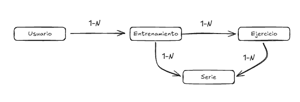

# Powerlifting Tracker

API REST para registrar y consultar entrenamientos de powerlifting. Permite gestionar usuarios, sus sesiones de entrenamiento, un catálogo de ejercicios (sentadilla, press banca, peso muerto...) y las series realizadas en cada sesión, con su peso y repeticiones.

Proyecto de portfolio desarrollado con Spring Boot siguiendo una arquitectura por capas (Controller, Service, Repository), validación de datos y manejo global de errores.

## Stack tecnológico

- Java 21
- Spring Boot 4.1.1
- Spring Web (API REST)
- Spring Data JPA con Hibernate
- PostgreSQL
- Bean Validation (Jakarta Validation)
- Lombok
- Maven

## Modelo de datos



- Un **usuario** tiene muchos **entrenamientos**.
- Un **entrenamiento** tiene muchas **series**.
- Un **ejercicio** (catálogo compartido) aparece en muchas **series**.

## Arquitectura

```
com.m.escudero.powerlifting_tracker
├── controller   → recibe las peticiones HTTP
├── service      → lógica de la aplicación
├── repository   → acceso a la base de datos (Spring Data JPA)
├── entity       → entidades JPA (Usuario, Entrenamiento, Ejercicio, Serie)
└── exception    → excepciones y manejo global de errores
```

## Endpoints

### Usuarios

| Método | Ruta | Descripción |
|--------|------|-------------|
| GET | `/usuarios` | Lista todos los usuarios |
| GET | `/usuarios/{id}` | Obtiene un usuario por su id |
| POST | `/usuarios` | Crea un usuario |
| DELETE | `/usuarios/{id}` | Elimina un usuario |

### Entrenamientos

| Método | Ruta | Descripción |
|--------|------|-------------|
| GET | `/entrenamientos` | Lista todos los entrenamientos |
| GET | `/entrenamientos/{id}` | Obtiene un entrenamiento por su id |
| POST | `/entrenamientos?usuarioId={id}` | Crea un entrenamiento para un usuario existente |
| DELETE | `/entrenamientos/{id}` | Elimina un entrenamiento |

### Ejercicios

| Método | Ruta | Descripción |
|--------|------|-------------|
| GET | `/ejercicios` | Lista todos los ejercicios |
| GET | `/ejercicios/{id}` | Obtiene un ejercicio por su id |
| POST | `/ejercicios` | Crea un ejercicio |
| DELETE | `/ejercicios/{id}` | Elimina un ejercicio |

### Series

| Método | Ruta | Descripción |
|--------|------|-------------|
| GET | `/series` | Lista todas las series |
| GET | `/series/{id}` | Obtiene una serie por su id |
| POST | `/series?entrenamientoId={id}&ejercicioId={id}` | Crea una serie asociada a un entrenamiento y a un ejercicio existentes |
| DELETE | `/series/{id}` | Elimina una serie |

### Ejemplos de cuerpo (JSON)

Crear un usuario:

```json
{ "nombre": "Miguel", "email": "miguel@correo.com" }
```

Crear un entrenamiento:

```json
{ "fecha": "2026-10-19", "comentario": "Sentadilla pesada" }
```

Crear un ejercicio:

```json
{ "nombre": "Sentadilla", "grupoMuscular": "Piernas" }
```

Crear una serie:

```json
{ "peso": 100, "repeticiones": 5 }
```

## Validaciones y manejo de errores

Los datos de entrada se validan antes de guardarse:

| Entidad | Campo | Regla |
|---------|-------|-------|
| Usuario | `nombre` | No puede estar vacío |
| Usuario | `email` | Obligatorio y con formato de email válido |
| Entrenamiento | `fecha` | Obligatoria |
| Ejercicio | `nombre`, `grupoMuscular` | No pueden estar vacíos |
| Serie | `peso`, `repeticiones` | Deben ser mayores que 0 |

Las respuestas de error son JSON claros, gestionados desde un único `GlobalExceptionHandler`:

- **400 Bad Request**: datos inválidos. Indica el campo y el motivo.

  ```json
  { "nombre": "no debe estar vacío", "email": "debe ser una dirección de correo electrónico con formato correcto" }
  ```

- **404 Not Found**: el recurso solicitado no existe.

  ```json
  { "mensaje": "Usuario no encontrado con id: 999" }
  ```

## Cómo ejecutarlo

### Requisitos previos

- Java 21
- PostgreSQL en el puerto 5432
- Git

### Pasos

1. Clona el repositorio:

   ```bash
   git clone https://github.com/M-Escudero/powerlifting-tracker.git
   cd powerlifting-tracker
   ```

2. Crea una base de datos vacía llamada `powerlifting` en PostgreSQL. Las tablas las crea Hibernate al arrancar la aplicación.

3. Define la contraseña del usuario `postgres` en la variable de entorno `DB_PASSWORD` (la aplicación la lee desde `application.properties`, así no queda escrita en el código):

    - Windows (PowerShell):

      ```powershell
      $env:DB_PASSWORD = "tu_contraseña"
      ```

    - macOS / Linux:

      ```bash
      export DB_PASSWORD="tu_contraseña"
      ```

4. Arranca la aplicación:

    - Windows:

      ```powershell
      .\mvnw.cmd spring-boot:run
      ```

    - macOS / Linux:

      ```bash
      ./mvnw spring-boot:run
      ```

5. La API queda disponible en `http://localhost:8080`.

### Configuración de la base de datos

La conexión está en `src/main/resources/application.properties`:

```properties
spring.datasource.url=jdbc:postgresql://localhost:5432/powerlifting
spring.datasource.username=postgres
spring.datasource.password=${DB_PASSWORD}
spring.jpa.hibernate.ddl-auto=update
```

Si tu usuario o tu puerto de PostgreSQL son distintos, ajusta esos valores.

## Mejoras previstas

- DTOs y mappers para devolver solo los datos necesarios en cada respuesta.
- Paginación en los listados.
- Tests automáticos.

## Autor

Miguel Escudero · [GitHub](https://github.com/M-Escudero)